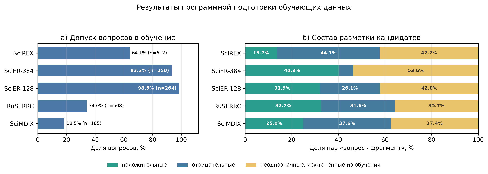

# Аудит подготовки обучающих примеров

Дата пересчёта: 9 октября 2026 г.

## Область подсчёта

Статистика пересчитана непосредственно из файлов, используемых итоговым benchmark. Test-части не открывались и в подсчёт не включались. Для SciREX учтены train и dev, для SciER обеих конфигураций official train и official dev, для RuSERRC train и development без calibration, для SciMDIX official train, внутри которого формировалась validation-часть.

SciER-128 и SciER-384 содержат одни и те же исходные документы. Их нельзя суммировать как независимые корпуса.

## Правила выделения классов

Для пары «вопрос - фрагмент» применялась следующая последовательность.

1. Официальные символьные или токенные интервалы переносились в координаты фрагмента. Фрагмент получал признак `gold_supporting`, если полностью содержал официальное упоминание соответствующего аспекта.
2. Замороженная модель извлечения ответа обрабатывала каждый доступный фрагмент. Результат считался согласованным с эталоном, если нормализованная эталонная последовательность целиком входила в предсказание и модель добавляла не более пяти токенов. Точное совпадение является частным случаем этого правила.
3. Согласованный ответ образовывал `qa_positive` или `robust_positive`. Положительный фрагмент мог не иметь официального спана, если модель воспроизводила эталонный ответ в другом контексте документа. Такие случаи учитываются отдельно.
4. Официально подтверждающий фрагмент без согласованного ответа модели относился к `evidence_positive_qa_failed`. Он не становился отрицательным примером.
5. Из фрагментов без положительного ответа и без официального подтверждения BM25 выбирал пять ближайших к вопросу кандидатов.
6. Векторные представления положительных и BM25-кандидатов кластеризовались. Кандидат из одного кластера с положительным фрагментом помещался в `false_negative_candidate` и исключался из отрицательного обучения.
7. Оставшиеся BM25-кандидаты образовывали `hard_negative`, остальные фрагменты образовывали `easy_negative`.
8. Если у вопроса не находилось ни одного положительного фрагмента, весь вопрос исключался из обучения, но сохранялся в аудиторском файле.

## Объём итоговых обучающих данных

| Набор данных | Исходные вопросы | Допущено в обучение | Доля допуска | Документы после фильтра | Пар «вопрос - фрагмент» | Строгих обучающих пар | В карантине |
|---|---:|---:|---:|---:|---:|---:|---:|
| SciREX | 955 | 612 | 64,1% | 324 | 12 062 | 6 972 | 5 090 |
| SciER-384 | 268 | 250 | 93,3% | 90 | 2 524 | 1 171 | 1 353 |
| SciER-128 | 268 | 264 | 98,5% | 90 | 11 623 | 6 742 | 4 881 |
| RuSERRC | 1 492 | 508 | 34,0% | 300 | 2 055 | 1 321 | 734 |
| SciMDIX | 1 001 | 185 | 18,5% | 125 | 1 026 | 642 | 384 |

Строгие обучающие пары включают подтверждённые положительные, сложные отрицательные и простые отрицательные фрагменты. Карантин включает официальное подтверждение без успешного ответа модели, вероятный ложноотрицательный фрагмент и унаследованный класс `question_sensitive`.

## Состав классов внутри допущенных вопросов

| Набор данных | Положительные | Сложные отрицательные | Простые отрицательные | Официальное подтверждение без ответа | Вероятные ложноотрицательные | Question-sensitive |
|---|---:|---:|---:|---:|---:|---:|
| SciREX | 1 657 | 963 | 4 352 | 2 466 | 1 948 | 676 |
| SciER-384 | 1 017 | 102 | 52 | 1 134 | 219 | 0 |
| SciER-128 | 3 710 | 195 | 2 837 | 4 048 | 833 | 0 |
| RuSERRC | 672 | 623 | 26 | 218 | 372 | 144 |
| SciMDIX | 256 | 339 | 47 | 165 | 219 | 0 |

## Внутренняя чистота разметки

| Набор данных | Точное восстановление границ | Отрицательные с официальным спаном | Дополнительные положительные без официального спана | Доля подтверждения evidence | Карантин близких негативов |
|---|---:|---:|---:|---:|---:|
| SciREX | 100,0% | 0 | 0 | 31,5% | 66,9% |
| SciER-384 | 100,0% | 0 | 2 | 45,2% | 68,2% |
| SciER-128 | 100,0% | 0 | 55 | 47,6% | 81,0% |
| RuSERRC | 100,0% | 0 | 0 | 30,9% | 37,4% |
| SciMDIX | 100,0% | 0 | 4 | 13,4% | 39,2% |

Проверено 78 329 эталонных спанов; каждый текст спана точно совпал с соответствующей подстрокой фрагмента. Ни один `hard_negative` или `easy_negative` не содержал официального подтверждающего спана. Это подтверждает внутреннюю непротиворечивость программной разметки, но не заменяет ручную оценку семантической полноты: альтернативное подтверждение может отсутствовать в исходной аннотации.

«Доля подтверждения evidence» равна отношению положительных фрагментов к сумме положительных и официально подтверждающих фрагментов, на которых reader не воспроизвёл ответ. Низкое значение SciMDIX указывает прежде всего на несовместимость текущих вопросов и русскоязычного reader с официальной разметкой; оно не означает ошибочность самих спанов.

«Карантин близких негативов» равен `false_negative_candidate / (false_negative_candidate + hard_negative)`. Высокие значения показывают, что прямое использование BM25 top-5 создало бы значительную долю потенциально противоречивых отрицательных примеров. Для SciER-128 в карантин перемещён 81,0% этого пула.



## Воспроизводимость

Расчёт выполняется командой:

```bash
./untie_venv/bin/python3 articles/data_article/data_preparation_audit/analyze_training_examples.py
```

Сценарий только читает готовые артефакты и создаёт сводные CSV, JSON и график в текущем каталоге. Модельный прогон не выполняется.
