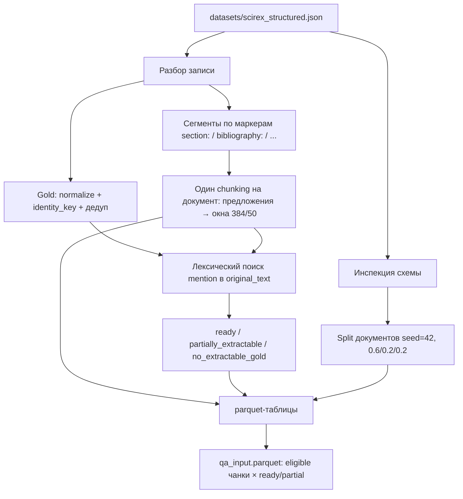

# Предобработка SciREX для aspect-level extractive QA

Документ описывает **как предобработка реально устроена в коде**, а не черновик постановки. Спецификация, по которой пайплайн писали, лежит в [`hypothesis/scirex_aspect_qa_preprocessing_prompt.md`](../hypothesis/scirex_aspect_qa_preprocessing_prompt.md). Реализация: пакет `untie/aspect_qa/`. Результат прогона: `datasets/scirex_aspect_qa_preprocessing/`.

Это **не** Phase 1 (QA, BM25, hard negatives). Предобработка останавливается на таблицах документов, чанков, gold-упоминаний и QA-входов. Frozen QA по этим таблицам запускается отдельно.

Запуск:

```bash
python -m untie.aspect_qa --input datasets/scirex_structured.json \
  --output datasets/scirex_aspect_qa_preprocessing
```

Исходный файл при этом **не перезаписывается**.

---

## 1. Задача и границы

Из сырого SciREX нужно получить набор, в котором:

- единица gold — сущность аспекта (`method` / `task` / `metric` / `material`), а не triple и не `score`;
- gold подтверждён **лексическим вхождением в текст статьи** (режим E0, source-only);
- чанки одни на документ и переиспользуются всеми аспектами;
- offsets mention и chunk указывают на **сырой** `original_text`;
- split документа детерминированный и общий для всех аспектов.

Явно не делается на этом шаге:

- синонимы, стемминг, аббревиатуры, внешние канонические имена;
- `score` как QA-аспект (`ENABLE_SCORE_ASPECT=False`);
- enrichment извне (`external_enrichment` и `enrichment_candidates` пустые, `used_for_gold` запрещён);
- запуск QA-модели, attention, KeyBERT, BM25, кластеризация.



---

## 2. Источник

Файл: `datasets/scirex_structured.json`. Формат на диске — **JSONL** (по объекту на строку), не JSON-массив. Парсер сначала пробует `json.loads` всего файла, при ошибке читает построчно — та же стратегия, что у `untie.data`.

Ожидаемые поля каждой записи:

| поле | роль |
|---|---|
| `doc_id` | идентификатор документа |
| `original_text` | полный текст статьи со структурными маркерами |
| `methods` | список сырых gold method |
| `tasks` | список сырых gold task |
| `metrics` | список сырых gold metric |
| `materials` | список сырых gold material |
| `score` | числовые/строковые scores; **только метаданные**, не аспект QA |

На прогоне 306 записей, все семь полей на месте, лишних полей нет. Отчёт инспекции пишется в `source_inspection.json`. Если не хватает обязательных полей — пайплайн отказывается угадывать переименования и останавливается.

Типы списков: только строки / числа, приведённые к строке. Вложенные объекты в `methods`/`tasks`/… запрещены.

---

## 3. Split

Split **документальный**, не по аспектам и не по чанкам. Считается по полному списку `doc_id` корпуса (даже если `--limit` обработает подмножество), функцией `deterministic_document_split`:

1. уникальные id, сортировка;
2. порядок: SHA-256(`"{seed}\0{doc_id}"`), при коллизии сам `doc_id`;
3. отрезать `train_fraction=0.6`, затем `dev_fraction=0.2`, хвост — `test`.

`seed=42`. На полном корпусе: **train 183 / dev 61 / test 62**.

Колонка `split` есть в `documents`, `aspect_instances`, `qa_input`, `source_metadata`. В `chunks.parquet` и `gold_mentions.parquet` её нет — join по `document_id`.

Порядок записей в исходном JSONL на split не влияет.

---

## 4. Структурные сегменты

Текст режется **не** по PDF-заголовкам, а по маркерам, которые реально встречаются в `original_text`:

`document:`, `section:`, `subsection:`, `subsubsection:`, `paragraph:`, `bibliography:`, `appendix:`

Регулярка: слово-маркер + необязательные пробелы + `:`, без учёта регистра. Смещения сегмента — сырые индексы в `original_text`.

Кусок до первого маркера (часто заголовок статьи) становится сегментом с пустым `type`. У сегмента берётся короткий `title` — префикс тела после маркера (`Abstract`, `Related Work`, …), это только метаданные, не новый текст.

Bibliography **не выкидывается** из документа и из чанков. Он нужен, чтобы знать, где mention, и чтобы не считать библиографию основным QA-evidence (см. §8).

---

## 5. Чанкинг: один набор на документ

Чанки строятся **один раз** на `original_text`. Все четыре аспекта ссылаются на одни и те же `chunk_id`. Отдельного чанкинга «под вопрос» нет.

### 5.1. Токенизатор и бюджет

Токенизатор — тот же, что у English extractive QA (`qa_model`, RoBERTa QA). Fallback для тестов: whitespace.

Размер окна не «просто 384». Считается бюджет контекста:

```text
chunk_max = min(configured_384, model_max_length − tokens(самый длинный аспектный вопрос) − special_tokens_pair)
```

`model_max_length` по умолчанию 512. На прогоне получилось **384**, overlap **50** (из `PipelineConfig`).

### 5.2. Предложения и длинные предложения

`SentenceSplitter` режет текст на предложения. Каждое предложение **ищется как подстрока** `original_text` (курсор двигается вперёд), чтобы не потерять offsets.

Если предложение длиннее `max_tokens`, оно пилится на токенные окна. Предпочтительно через HuggingFace `offset_mapping`; если токенизатор offsets не отдаёт — восстановление по surface-формам токенов (`Ġ` / `▁` / `##` снимаются).

### 5.3. Сборка чанков

`ChunkBuilder` набирает предложения, пока сумма токенов не превысит `max_tokens`. При переполнении текущий чанк закрывается, в следующий переносится хвост предыдущего на ≈ `overlap_tokens` предложений.

Важно: внутренний `TextChunk.text` у билдера — склейка предложений через пробел. В таблицу пишется **не это**, а срез сырого текста:

```text
chunk_text = original_text[char_start:char_end]
```

`char_start` / `char_end` — min/max по предложениям чанка. Инвариант: срез всегда равен `chunk_text`.

### 5.4. Секция и eligible_for_qa

На чанк вешаются сегменты, с которыми он пересекается. Если пересечение ровно с одним сегментом — заполняются `section_type` и `section_title`, иначе оба пустые.

`eligible_for_qa = false`, только если чанк **целиком** лежит внутри bibliography-сегмента (и флаг `include_bibliography_in_qa=False`). Частично библиографические или обычные чанки eligible. Библиографические чанки остаются в `chunks.parquet`, но не попадают в `qa_input`.

На прогоне: **306 документов, 5964 чанка**.

---

## 6. Нормализация gold

Нормализация меняет только поверхность. Синонимы, леммы, переводы, раскрытие аббревиатур **запрещены**.

Две функции:

**`normalize_entity`** (каноническая запись для таблиц):

1. Unicode NFKC;
2. типографские тире → ASCII `-`;
3. `_` → пробел (`Semantic_Segmentation` → `Semantic Segmentation`, `Frame__fps_` → `Frame fps`);
4. схлопнуть пробелы, trim.

**`identity_key` / `matching_key`** (сравнение и поиск):

5. то же, плюс пробелы вокруг дефиса убрать (`F - measure` → `f-measure`);
6. `casefold()`.

Дедупликация: сырые строки с одним `identity_key` сливаются в одну сущность. Все raw-варианты сохраняются. Каноническая форма — `normalize_entity` варианта с наибольшим числом заглавных букв (чтобы `fastText`, а не `fasttext`).

`score` в сущности аспектов не превращается.

---

## 7. Поиск mention

Для каждой канонической сущности строится поисковый индекс по **всему** `original_text`:

- посимвольно те же технические преобразования, что у `identity_key`;
- карта «позиция в свёрнутой строке → позиция в сыром тексте».

Иголки: `identity_key` всех raw- и normalized-вариантов, длинные сначала. Поиск с границами слова: `(?<!\w)needle(?!\w)`. Перекрывающиеся спаны не берутся повторно.

Найденный кусок переносится обратно в сырой текст: `matched_text = original_text[char_start:char_end]`. Это обязательный инвариант.

Mention в bibliography помечается `in_bibliography=true`. При `include_bibliography_in_qa=false` такой mention **не** делает сущность extractable и **не** добавляет chunk в `gold_supporting_chunk_ids` (если чанк не eligible).

Сущность **extractable**, если есть хотя бы один eligible mention вне этой библиографической блокировки. Иначе — unextractable: gold есть в метаданных статьи, в пригодном для QA тексте его нет.

---

## 8. Аспектные инстансы и статусы

На документ создаются ровно четыре инстанса. Вопросы фиксированы конфигурацией, это не факты из статьи:

| аспект | поле источника | вопрос |
|---|---|---|
| method | methods | What method or model is used or proposed in the paper? |
| task | tasks | What task is addressed in the paper? |
| metric | metrics | What evaluation metric is used in the paper? |
| material | materials | What dataset or material is used in the paper? |

Статус инстанса:

| статус | условие |
|---|---|
| `ready` | все канонические gold extractable, unextractable пуст |
| `partially_extractable` | есть и extractable, и unextractable |
| `no_extractable_gold` | ни одного extractable |

`gold_supporting_chunk_ids` — чанки, которые **пересекаются** с eligible mention этого аспекта. Один mention может покрывать несколько чанков из-за overlap.

`chunk_ids` у инстанса — все чанки документа, не только supporting.

На полном корпусе (306 документов × 4 аспекта = 1224 инстанса):

| аспект | ready | partial | no_extractable | extractability gold |
|---|---:|---:|---:|---:|
| method | 158 | 39 | 109 | 0.50 |
| task | 207 | 21 | 78 | 0.69 |
| metric | 126 | 60 | 120 | 0.45 |
| material | 131 | 50 | 125 | 0.32 |

Extractability — доля уникальных gold-сущностей, для которых нашлось eligible mention, не доля документов.

---

## 9. Таблица QA-входов

`qa_input.parquet` — декартово произведение:

- инстансы со статусом `ready` или `partially_extractable`;
- чанки с `eligible_for_qa=true`.

`no_extractable_gold` сюда не входит. У каждой строки флаг `gold_supporting` (этот чанк в `gold_supporting_chunk_ids` или нет) и полный список `extractable_gold_answers` инстанса. `enrichment_mode="E0"`.

На прогоне: **15 405** строк.

Это ещё не ответы модели. Это входы, по которым Phase 1 гоняет frozen QA.

---

## 10. Выходные файлы

Каталог: `datasets/scirex_aspect_qa_preprocessing/`. Исходный SciREX не копируется и не правится.

| файл | содержание |
|---|---|
| `documents.parquet` | `document_id`, `split`, `raw_text`, `clean_text` (нормализация всего текста только для отображения), числа чанков/сегментов, параметры окна |
| `chunks.parquet` | один ряд на чанк: текст, char/token offsets, секция, `eligible_for_qa` |
| `aspect_instances.parquet` | `(document_id, aspect)`: вопрос, статус, raw/canonical/extractable/unextractable gold, supporting chunk ids |
| `gold_mentions.parquet` | каждое найденное вхождение: offsets, `matched_text`, `in_bibliography`, покрывающие `chunk_ids` |
| `source_metadata.parquet` | сырые списки methods/tasks/metrics/materials/`score` как в источнике |
| `enrichment.parquet` | пустая схема с `used_for_gold`; в E0 строк нет |
| `qa_input.parquet` | см. §9 |
| `preprocess_config.json` | зафиксированные флаги прогона |
| `source_inspection.json` | инспекция схемы |
| `statistics.json` | счётчики по split и аспекту |
| `manual_review_sample.json` | детерминированные 20 документов для ручной проверки |

`clean_text` **не** используется для offsets. Mention и chunk всегда смотрят в `raw_text` / `original_text`.

---

## 11. Инварианты, которые пайплайн проверяет на каждом документе

После обработки документа `validate_processed_document`:

- `original_text[mention.char_start:char_end] == matched_text`;
- `original_text[chunk.char_start:char_end] == chunk_text`;
- каждый canonical прослеживается до raw через `identity_key`;
- у extractable gold есть хотя бы один non-bibliography mention; у unextractable таких нет;
- `external_enrichment` / `enrichment_candidates` не помечены `used_for_gold`;
- аспект `score` отсутствует;
- статус согласован с непустотой extractable/unextractable списков.

Падение инварианта — ошибка прогона, не «тихий» skip.

---

## 12. Что сознательно оставлено снаружи

- **Нет отдельного чанкинга на аспект.** Иначе supporting-чанки нельзя было бы сравнивать между method и task.
- **Bibliography в тексте есть, в QA-входах — нет** (пока флаг выключен). Mention там не делает сущность extractable.
- **`score` не вопрос.** Нет relation-меток, какой score к какой (method, metric, dataset) тройке относится.
- **Gold не расширяется.** Если в тексте «Cityscapes validation set», а gold «Cityscapes», mention найдётся только если после нормализации выполняется поиск с границами слова по ключу `cityscapes`. Обратное («длиннее gold») предобработка не конструирует.
- **Дефис vs пробел.** `BRATS-2013` и `BRATS 2013` — разные `identity_key` (`brats-2013` ≠ `brats 2013`). Это ограничение нормализации, не баг поиска.

---

## 13. Связь с Phase 1

Phase 1 **не пересчитывает** чанки, split и gold. Она читает эти parquet, берёт только `ready` / `partially_extractable`, гоняет frozen QA по eligible чанкам и вешает классы `qa_positive` / FN / hard negative.

`gold_supporting` здесь — «в чанке есть mention». `qa_positive` там — «спан модели совпал с extractable gold» (exact match, затем gold⊆pred с капом). Это разные признаки; предобработка знает только первый.

Повторный preprocessing для смены match-критерия Phase 1 не нужен.
