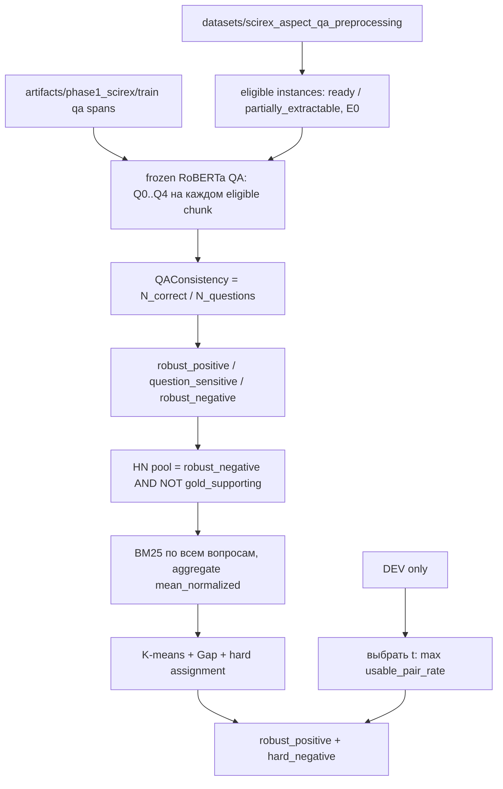

# Multi-question расширение Phase 1 на SciREX

Документ описывает **как эксперимент устроен в коде**, что уже посчитано, и как продолжить прогон. Постановка одновопросной Phase 1: [`hypothesis/phase1_positive_hard_negative_experiment_scirex.md`](../hypothesis/phase1_positive_hard_negative_experiment_scirex.md). Предобработка: [`docs/scirex-aspect-qa-preprocessing.md`](scirex-aspect-qa-preprocessing.md). Реализация: пакет `experiments/phase1_multiquestion/`. Артефакты: `artifacts/phase1_multiquestion/`.

Это **не** предобработка и **не** одновопросная Phase 1. Пайплайн читает готовые таблицы `datasets/scirex_aspect_qa_preprocessing/` и pred-спаны `artifacts/phase1_scirex/train/`, но **никогда в них не пишет**. TEST не запускается, пока алгоритм не заморожен.

Продолжение с последнего завершённого шага:

```bash
./untie_venv/bin/python -m experiments.phase1_multiquestion.continue --device cuda:0
# или
./scripts/run_phase1_multiquestion_continue.sh --device cuda:0
```

Сначала можно посмотреть, что осталось, без GPU:

```bash
./untie_venv/bin/python -m experiments.phase1_multiquestion.continue --dry-run
```

---

## 1. Задача и границы

Одновопросная Phase 1 помечает чанк `qa_positive`, если frozen RoBERTa QA на **одном** каноническом вопросе извлекает extractable gold. Это смешивает два разных события:

- модель стабильно находит ответ в чанке;
- модель случайно угадала формулировку вопроса.

Расширение держит **тот же аспект, те же gold-ответы, те же чанки**, но гоняет QA по фиксированному набору из 3–5 семантически эквивалентных вопросов. Цель:

> для каждого `(document_id, aspect, chunk_id)` измерить устойчивость extractive QA к перефразировке вопроса и строить positive / hard-negative множества от **порога согласованности**, а не от «хотя бы один вопрос угадал».

Единица эксперимента по-прежнему пара `(document_id, aspect)`. Чанки документа общие для всех аспектов. Вопросы **одни и те же для всех документов**: в них нет имён моделей, датасетов и прочих фактов конкретной статьи.

Явно не делается:

- переписывание предобработки и `extractable_gold_answers`;
- добавление gold из успешных QA-ответов на парафразы;
- правило «any correct → positive» как основной критерий (только диагностика);
- подбор порога на TRAIN или TEST;
- полный TEST-прогон;
- `score` как аспект (`enable_score_aspect=False`);
- enrichment (`E0`, source-only);
- temperature decay у Gumbel (Gumbel — опциональная абляция FN-фильтра).



---

## 2. Изоляция данных

| путь | роль | запись |
|---|---|---|
| `datasets/scirex_structured.json` | сырой SciREX | запрещена |
| `datasets/scirex_aspect_qa_preprocessing/` | чанки, gold, split | **только чтение** |
| `artifacts/phase1_scirex/train/` | одновопросный containment-baseline | **только чтение** (Q0 TRAIN spans) |
| `artifacts/phase1_scirex/train_exact_match/` | архив exact-match | не трогается |
| `artifacts/phase1_multiquestion/` | все выходы этого эксперимента | единственное место записи |
| `artifacts/phase1_multiquestion/qa_prediction_cache.jsonl` | общий QA-кэш Q0–Q4 | append |

`assert_isolated_output` отказывается писать внутрь preprocessing. Sanity-check сравнивает `extractable_gold_answers` с предобработкой по `identity_key` и падает, если gold сдвинулся. Дополнительные вопросы **не** расширяют gold.

---

## 3. Вход и фильтры

Читаются те же parquet-таблицы предобработки, что и одновопросная Phase 1.

Допускаются только:

- аспекты `method` / `task` / `metric` / `material`;
- статусы `ready` / `partially_extractable`;
- `enrichment_mode = E0`;
- чанки с `eligible_for_qa=true` (библиография не главная QA-улика).

`no_extractable_gold` исключается: без extractable gold нельзя пометить `qa_correct`.

Split документальный, seed=42, 0.6/0.2/0.2 из предобработки. На TRAIN eligible после фильтра: **178 документов, 465 instance** (как в containment Phase 1). DEV: **60 документов, 159 instance**. TEST не гоняется.

---

## 4. Наборы вопросов Q0 / Q3 / Q5

Фиксированный список на аспект лежит в `experiments/phase1_multiquestion/questions.py`. Индекс 0 **обязан** совпадать с `untie.aspect_qa.config.ASPECT_QUESTIONS`. `assert_canonical_baseline()` это проверяет при каждом запуске.

Q0 = `[:1]`, Q3 = `[:3]`, Q5 = `[:5]`. Порядок не переставляется: сравнение режимов держит одни и те же первые вопросы.

### method

0. `What method or model is used or proposed in the paper?` — канон
1. `Which method or model does the paper use or propose?`
2. `What method or model is introduced or employed in the paper?`
3. `Which modeling approach is used or proposed in the paper?`
4. `What method or model is presented in the paper?`

### task

0. `What task is addressed in the paper?`
1. `Which task does the paper address?`
2. `What is the main task studied in the paper?`
3. `Which task is the focus of the paper?`
4. `What task is the paper concerned with?`

### metric

0. `What evaluation metric is used in the paper?`
1. `Which evaluation metric does the paper use?`
2. `What metric is used to evaluate the results in the paper?`
3. `Which performance metric is reported in the paper?`
4. `What evaluation measure is used in the paper?`

### material

0. `What dataset or material is used in the paper?`
1. `Which dataset or material does the paper use?`
2. `What data or dataset is used in the paper?`
3. `Which dataset is used in the paper?`
4. `What material or dataset is employed in the paper?`

Ни один вариант не содержит document-specific entity. Extra-вопросы не добавляют новых gold и не меняют `extractable_gold_answers`.

---

## 5. Frozen QA на каждом варианте

Для каждой тройки `(document_id, aspect, chunk_id)` и каждого вопроса режима модель отвечает отдельно. Модель та же, что в Phase 1: frozen extractive RoBERTa QA (`untie.models.ExtractiveQuestionAnswerer`), device по умолчанию в continue-скрипте — `cuda:0`.

На каждый вопрос сохраняется:

- `question_id`, `question`;
- `qa_predicted_answer`, `answer_start` / `answer_end`, logits;
- `qa_confidence`;
- `matched_gold_answer`, `qa_correct`, `match_type`, `extra_tokens`;
- `answer_quality` (token-F1, **не** метка класса).

### Откуда берётся предсказание (приоритет)

1. JSONL-кэш `(document_id, aspect, chunk_id, question_id)` → `qa_prediction_cache.jsonl`.
2. Если `question_id == 0` и split=TRAIN — сохранённый span из `artifacts/phase1_scirex/train/qa_chunk_dataset.parquet` (containment rematch; сами спаны не пересчитывались).
3. Иначе — новый вызов frozen QA, строка дописывается в кэш.

Поэтому DEBUG/DEV Q5 уже прогрели кэш для своих документов. TRAIN Q5 должен переиспользовать канонические TRAIN-спаны для q0 и считать только q1–q4. TRAIN Q3 после Q5 должен быть почти целиком из кэша.

Match **не** пересчитывает QA: `qa_correct` всегда `classify_match` по сохранённому тексту ответа.

---

## 6. Match: `gold_span_containment`

Тот же критерий, что в текущем одновопросном TRAIN (`experiments/phase1_scirex/match.py`).

Нормализация ключа — `untie.aspect_qa.normalize.identity_key`:

- NFKC;
- типографские тире → `-`;
- `_` → пробел;
- схлопывание пробелов;
- ` - ` → `-`;
- casefold.

Синонимы, стемминг, аббревиатуры **выключены**. `BRATS 2013` ≠ `BRATS-2013`.

Положительный match, если после токенизации ключа **gold является contiguous span внутри pred** (для униграммы допускается вхождение как hyphen-part, например gold `LiteFlowNet` в pred `LiteFlowNet-ft`). Направление только **gold ⊆ pred**. Недоизвлечение (pred короче gold) отвергается. Cap: `containment_max_extra_tokens=5`. Exact identity — частный случай с `extra_tokens=0`.

Token-F1 пишется в `answer_quality` и **не** решает класс чанка.

---

## 7. QAConsistency и классы согласованности

\[
\mathrm{QAConsistency}(c) = \frac{N_{\mathrm{correct}}(c)}{N_{\mathrm{questions}}}
\]

`N_questions` = 1 / 3 / 5 в режимах Q0 / Q3 / Q5. Три метки **взаимно исключают** друг друга:

| метка | условие |
|---|---|
| `robust_negative` | consistency = 0 |
| `question_sensitive` | \(0 < \mathrm{consistency} < t\) |
| `robust_positive` | consistency ≥ \(t\) |

Порог \(t\) выбирается на DEV (см. §10). Для Q0 consistency ∈ {0, 1}, поэтому \(t = 1\) фиксирован: `robust_positive` ≡ канонический `qa_correct`.

`any_correct = (N_correct > 0)` пишется рядом как диагностика. **Основное правило positive — не any-correct.** На DEV Q5 это видно численно: 448 any-correct чанков против 289 `robust_positive` при \(t=0.6\).

---

## 8. Primary-классы чанка и hard negatives

После согласованности чанк получает ровно один `primary_class`.

### 8.1. Позитивы

Позитивы instance = чанки с `consistency_class == robust_positive`. Если таких нет, instance получает `instance_status = no_robust_positive`, HN-множество пустое, FN-фильтр не запускается.

`question_sensitive` **не** позитив и **не** HN.

### 8.2. Gold-supporting при cons=0 — не HN

Чанк с gold mention (`gold_supporting=true`) и `robust_negative` помечается `gold_supporting_robust_negative`. Это наследник `evidence_positive_qa_failed` одновопросной схемы: улика есть, QA устойчиво молчит. В пул HN он **не** попадает.

### 8.3. Пул и BM25

Пул HN-кандидатов:

```text
eligible_for_qa
AND consistency_class == robust_negative
AND gold_supporting == false
```

По каждому вопросу считается BM25(question, chunk_text) с k1=1.5, b=0.75. Для каждого вопроса сохраняются сырой score, min-max нормализация по чанкам instance и rank (1 = лучший). Агрегации:

| метод | смысл | роль |
|---|---|---|
| `mean_normalized` | среднее min-max BM25 по вопросам | **основной** hardness |
| `rrf` | Reciprocal Rank Fusion, k=60 | диагностика / альтернатива |
| `mean_rank` | средний rank; hardness = `(n+1) - mean_rank` | диагностика |

Top-N=5 из пула по hardness идут в FN-фильтр. Jaccard top-5 трёх агрегаций пишется в `statistics.json` (`bm25_top5_overlap`). На DEV Q5 mean_normalized vs RRF ≈ 0.84, RRF vs mean_rank ≈ 0.98.

### 8.4. FN-фильтр (без изменений идеи)

На **passage embeddings чанков** (C0, passage-only, не QA-span):

1. K-means;
2. Gap statistic (bootstrap=10, seed=42, k_max_cap=10, min_cluster_points=3);
3. hard assignment.

Чанк из top-5, попавший в тот же кластер, что хотя бы один `robust_positive`, исключается из HN и становится `false_negative_candidate`. Если у него ещё и есть gold mention — `confirmed_false_negative` и sanity-проблема (на DEV/DEBUG таких не было). Остаток top-5 — `hard_negative`. Прочие негативы — `easy_negative`.

Gumbel — флаг `--gumbel-ablation`, без temperature decay. По умолчанию выключен.

### 8.5. Итоговая exclusive-схема

1. `robust_positive`
2. `question_sensitive`
3. `gold_supporting_robust_negative`
4. `false_negative_candidate` / `confirmed_false_negative`
5. `hard_negative`
6. `easy_negative`

Инварианты sanity (`experiments/phase1_multiquestion/checks.py`):

- gold совпадает с предобработкой;
- канонический вопрос не уехал;
- набор вопросов = `questions_for(aspect, n)`;
- HN не пересекается с gold_supporting, question_sensitive, robust_positive, FN;
- HN имеет cons=0 и `any_correct=false`;
- нет HN при `no_robust_positive`;
- offsets/текст чанка = предобработка;
- `qa_correct` воспроизводится match-функцией.

---

## 9. Режимы Q0 / Q3 / Q5 — что сравнивается

| режим | вопросы | порог | смысл |
|---|---|---|---|
| Q0 | только канон | 1.0 (фиксирован) | baseline одновопросной Phase 1 в той же схеме классов |
| Q3 | первые 3 | выбран на DEV из `{2/3, 1}` | короткое множество парафраз |
| Q5 | все 5 | выбран на DEV из `{3/5, 4/5, 1}` | полное множество |

Сравнение на **TRAIN** после заморозки DEV-порогов. Метрики (`experiments/phase1_multiquestion/compare.py`):

- число `robust_positive` / `question_sensitive` / `hard_negative`;
- `no_robust_positive_rate`;
- число instance с ≥1 robust_positive и ≥1 HN (`pos_hn_instances`);
- mean QAConsistency;
- разрез по аспектам;
- Jaccard HN-множеств и robust_positive-множеств между режимами.

Ожидаемый качественный эффект: больше вопросов → строже positive (если \(t\) не слишком низкий) и/или больше `question_sensitive`; HN-пул чище, потому что any-correct больше не протаскивает чанк в positive.

---

## 10. Протокол порога на DEV

Порог **только на DEV**. `--select-threshold` на TRAIN/TEST CLI отвергает.

После QA (которая от порога не зависит) каждый кандидат \(t\) только **переклеивает классы** через `relabel_with_threshold` и заново гоняет BM25+FN. Нового QA нет.

Критерий выбора:

> максимизировать `usable_pair_rate` = доля instance, у которых есть ≥1 `robust_positive` и ≥1 `hard_negative` после FN-фильтра. При равенстве берётся **больший** \(t\).

Записано в `threshold_selection.json`. Continue-скрипт сливает DEV-результаты в `artifacts/phase1_multiquestion/frozen_thresholds.json`:

```json
{
  "Q0": { "chosen_threshold": 1.0 },
  "Q3": { "chosen_threshold": 0.666... },
  "Q5": { "chosen_threshold": 0.6 }
}
```

TRAIN читает этот файл через `--threshold-file`. TEST по-прежнему запрещён (`run.py` возвращает код 2 на полном TEST).

### Уже выбранные пороги

**Q5 DEV** — \(t = 0.6\) (3 из 5):

| t | usable_pair_rate | robust_positive | question_sensitive | no_robust_positive |
|---|---|---|---|---|
| 0.6 | **0.390** | 289 | 159 | 54 |
| 0.8 | 0.371 | 240 | 208 | 63 |
| 1.0 | 0.321 | 176 | 272 | 79 |

**Q3 DEV** — \(t = 2/3\):

| t | usable_pair_rate | robust_positive | question_sensitive | no_robust_positive |
|---|---|---|---|---|
| 2/3 | **0.421** | 292 | 93 | 51 |
| 1.0 | 0.340 | 208 | 177 | 72 |

---

## 11. Код и CLI

| файл | роль |
|---|---|
| `questions.py` | 5 фиксированных парафраз, канон = Q0 |
| `config.py` | Q0/Q3/Q5, кандидаты порогов, match, BM25, FN |
| `consistency.py` | QAConsistency и exclusive labels |
| `bm25_multi.py` | per-question BM25, min-max, ranks, RRF |
| `assign.py` | robust_positive → пул → top-5 → FN |
| `engine.py` | QA, кэш, reuse канонических спанов, DEV threshold |
| `checks.py` | gold / HN / offsets / канон |
| `report.py` | parquet + statistics + summary md |
| `compare.py` | Q0 vs Q3 vs Q5 |
| `run.py` | CLI одного шага |
| `continue.py` | оркестратор продолжения |

Один шаг вручную:

```bash
./untie_venv/bin/python -m experiments.phase1_multiquestion \
  --mode Q5 --split train --threshold-file artifacts/phase1_multiquestion/frozen_thresholds.json \
  --output-dir artifacts/phase1_multiquestion/train_q5 \
  --cache-path artifacts/phase1_multiquestion/qa_prediction_cache.jsonl \
  --canonical-predictions artifacts/phase1_scirex/train/qa_chunk_dataset.parquet \
  --device cuda:0
```

Тесты: `tests/test_phase1_multiquestion.py` вместе с `tests/test_phase1_scirex.py`.

---

## 12. Как продолжить эксперимент

`continue.py` **не** перезапускает успешные шаги (есть `statistics.json` и пустой `sanity_errors.json`). TEST не входит в пайплайн.

Порядок шагов:

1. DEBUG Q5, 8 TRAIN docs — **уже сделано**
2. DEV Q5 + `--select-threshold` — **уже сделано**, \(t_{Q5}=0.6\)
3. DEV Q3 + `--select-threshold` — **уже сделано**, \(t_{Q3}=2/3\) (QA из кэша DEV Q5)
4. TRAIN Q0 — pending, encoder + reuse канонических спанов, \(t=1.0\)
5. TRAIN Q5 — pending, самый длинный шаг (~3–4 часа: q0 из Phase 1, q1–q4 frozen QA)
6. TRAIN Q3 — pending, после Q5 должен идти из кэша
7. compare Q0 vs Q3 vs Q5 — pending

Запуск оставшегося:

```bash
cd /home/aiserver/POLINA/UnTIE_project
./untie_venv/bin/python -m experiments.phase1_multiquestion.continue --device cuda:0
```

Полезные флаги:

| флаг | действие |
|---|---|
| `--dry-run` | печать статуса, без моделей |
| `--force` | пересчитать даже успешные шаги (кэш QA всё равно переиспользуется) |
| `--only train_q5` | один шаг |
| `--skip-compare` | остановиться после TRAIN |
| `--device cuda:0` | GPU |

Если процесс оборвётся на TRAIN Q5, повторный continue подхватит кэш: уже отвеченные `(doc, aspect, chunk, question_id)` не гоняются заново. Каталог `train_q5/` при этом считается неготовым, пока нет чистых `statistics.json` / `sanity_errors.json`, и шаг запустится снова (кластеризация/BM25 дешёвые относительно QA).

Не делать:

- `python -m untie.aspect_qa` заново;
- запись в `datasets/scirex_aspect_qa_preprocessing/`;
- перезапись `artifacts/phase1_scirex/train/`;
- `--split test` без явной заморозки алгоритма.

---

## 13. Выходы каждого прогона

Каталог шага (`debug_q5/`, `dev_q5/`, `train_q5/`, …):

| файл | содержимое |
|---|---|
| `qa_question_predictions.parquet` | одна строка на (instance, chunk, question): pred, match, BM25 |
| `qa_chunk_dataset.parquet` | одна строка на (instance, chunk): consistency, primary_class, hardness |
| `qa_instances.parquet` | списки chunk_id по классам, вопросы, gold |
| `robust_positive_chunks.parquet` и остальные class-срезы | подмножества chunk-таблицы |
| `experiment_config.json` | режим, порог, device, match, BM25 aggregate |
| `statistics.json` | агрегаты, by_aspect, pairwise agreement, BM25 overlap |
| `sanity_errors.json` | должен быть `[]` |
| `phase1_summary.md` | человекочитаемый отчёт |
| `threshold_selection.json` | только DEV-шаги с `--select-threshold` |

Общие файлы корня `artifacts/phase1_multiquestion/`:

| файл | роль |
|---|---|
| `qa_prediction_cache.jsonl` | 17985 строк на момент после DEV; будет расти на TRAIN Q5 |
| `frozen_thresholds.json` | появляется при continue перед TRAIN |
| `q0_q3_q5_comparison.json` + `.md` | финальное сравнение TRAIN |

---

## 14. Текущие факты (на 28 Aug 2026)

Кэш: `artifacts/phase1_multiquestion/qa_prediction_cache.jsonl`, 17985 предсказаний. Sanity на всех завершённых шагах: 0 ошибок.

### DEBUG Q5 (8 TRAIN docs, t=1.0 для отладки)

23 instance, 550 пар, 31 robust_positive, 52 question_sensitive, 30 HN, 8 `no_robust_positive`.

### DEV Q5 (60 docs, выбран t=0.6)

159 instance, 3047 пар.

- robust_positive 289, question_sensitive 159, HN 154
- gold_supporting_robust_negative 619
- FN candidates 337
- no_robust_positive 54 / 159 (34%)
- Pos+HN instance 62 (pair_rate 0.390)
- canonical_correct (q0) 286 vs any_correct 448 — разрыв, ради которого и затевался порог
- pairwise qa_correct agreement 0.958
- metric самый ломкий: 24/39 instance без robust_positive

### DEV Q3 (тот же DEV, выбран t=2/3)

Те же 159 instance / 3047 пар, QA не пересчитывалась.

- robust_positive 292, question_sensitive 93, HN 176
- no_robust_positive 51 / 159
- Pos+HN 67 (pair_rate 0.421)
- any_correct 385 (три вопроса, не пять)

Q3 на DEV даёт чуть больше usable pairs, чем Q5: меньше вопросов → легче пройти \(t=2/3\), чем \(t=3/5\) на пяти, плюс другой кандидатный набор. Это и есть предмет TRAIN-сравнения, а не повод менять протокол.

### TRAIN Q0 / Q3 / Q5

Ещё не считались. Одновопросный containment-baseline (другая схема классов: `qa_positive` / `evidence_positive_qa_failed`) лежит отдельно в `artifacts/phase1_scirex/train/`: 465 instance, 812 qa_positive, 163 no_qa_positive, 185 Pos+HN, 485 HN. Q0 multi-question должен быть близок к этой картине по каноническому match, но метки называются `robust_positive` и сравниваются уже внутри multi-question пакета.

---

## 15. Инварианты — краткий список

1. Предобработка и сырой SciREX не переписываются.
2. Extra-вопросы не добавляют gold.
3. Канонический вопрос = `ASPECT_QUESTIONS`; Q3/Q5 только префиксы одного списка.
4. Вопросы не содержат фактов документа.
5. Match = `gold_span_containment`, extra≤5, `identity_key`.
6. Positive = QAConsistency ≥ t, не any-correct.
7. t выбирается только на DEV; Q0 t=1.
8. gold_supporting ∧ cons=0 → не HN.
9. HN ⊂ robust_negative ∩ ¬gold_supporting ∩ top-5 BM25 после FN.
10. FN-фильтр: K-means → Gap → hard assignment на passage embeddings.
11. Нет HN без хотя бы одного robust_positive.
12. TEST не гоняется continue-скриптом и полным CLI.
13. Одновопросный `artifacts/phase1_scirex/train/` — неприкосновенный baseline.

Если sanity_errors перестаёт быть пустым — шаг не считается завершённым, continue перезапустит его (при `--force` или если json отсутствует). Не чинить это правкой gold в предобработке.
